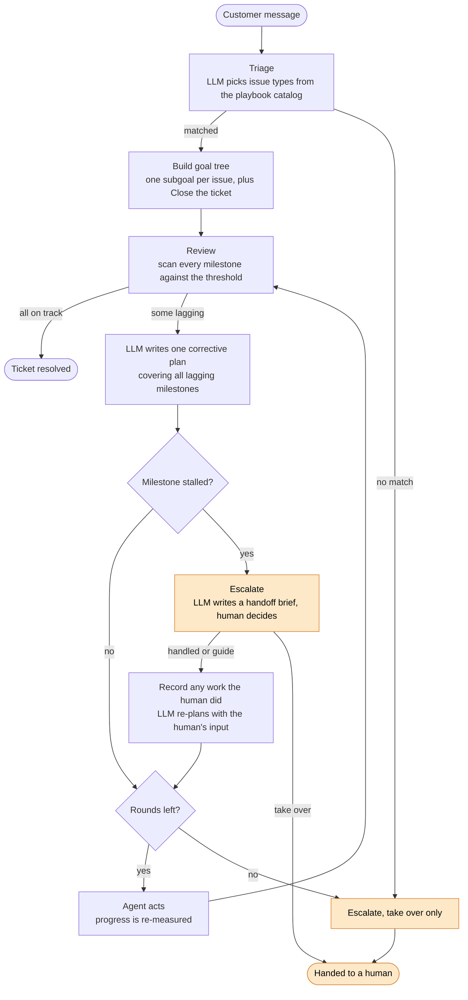
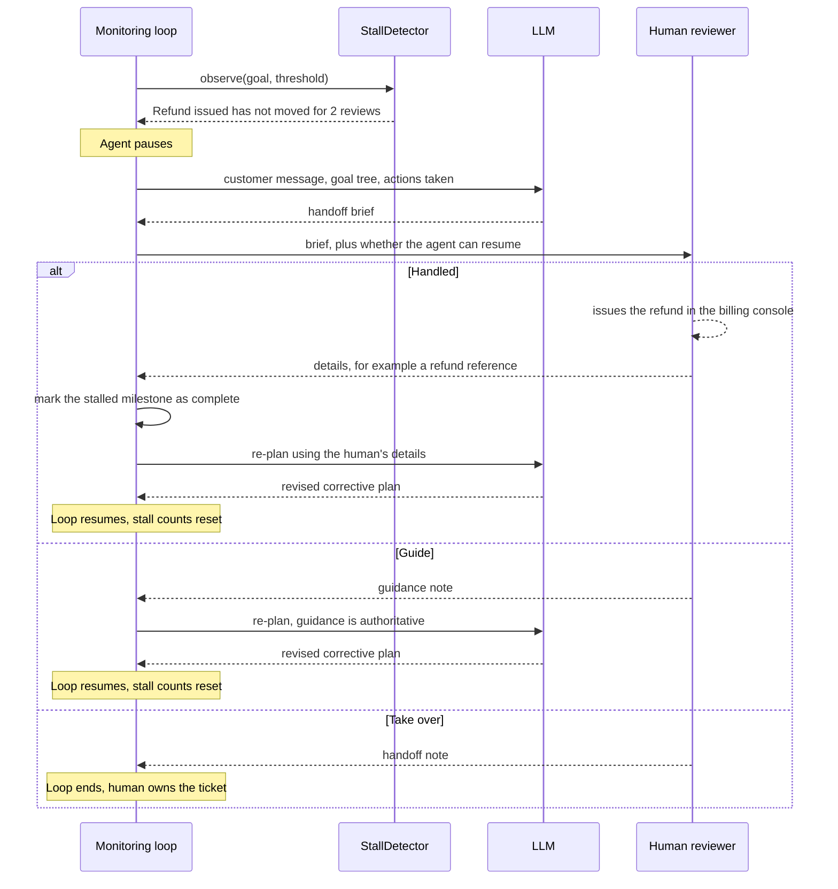

# Goal Setting and Monitoring

A long-running agent needs to know what "done" looks like, notice when it is falling behind, and know when to stop and ask a person. This pattern shows all three with a customer-support scenario:

- **Goal setting:** the LLM reads a free-text customer message and picks which known issue types it contains. A playbook for each issue turns into a hierarchical goal tree.
- **Monitoring:** every milestone is compared against a progress threshold. Only lagging milestones reach the LLM, which writes one corrective plan covering all of them. If nothing is lagging, no LLM call is made.
- **Course correction:** the agent acts, progress is re-measured, and the monitor reviews again. Each review sees the previous plan, so the LLM adjusts it instead of repeating itself.
- **Human-in-the-loop escalation:** when the agent should not continue alone, it pauses and briefs a human. The human can do the blocked step themselves and report the details back, guide the agent, or take over the ticket.

The code is in [main.py](main.py). Every LLM prompt is printed as the demo runs, so you can see exactly what the model was given at each stage.

## How it works



The orange nodes are the human-in-the-loop path.

### The pieces

| Piece | Role |
| --- | --- |
| `Playbook` / `PLAYBOOKS` | Standard resolution steps for one issue type. Triage chooses from this catalog, and each match becomes a subgoal. |
| `Milestone` | One measurable target (`current` of `target` steps). Progress is `current / target`, clamped to 0-100%. Carries a `corrective_action` hint for the LLM. |
| `Goal` | A named objective holding milestones and nested subgoals. Overall progress is the mean of its milestones and the overall progress of each subgoal. |
| `GoalMonitor` | Scans the tree, collects milestones below the threshold (70% by default), and makes a single LLM call for all of them. |
| `StallDetector` | Flags a milestone that has started but stopped moving across consecutive reviews. |
| `escalate()` and `Reviewer` | Pauses the agent, has the LLM write a handoff brief, and asks a human to decide: handle the step, guide the agent, or take over. |

The goal tree the demo builds for the customer's message:

```text
Resolve the customer's support request
├── Resolve the damaged item
│   ├── Damage verified (2 steps)
│   └── Replacement shipped (3 steps)
├── Refund the duplicate charge
│   ├── Duplicate charge confirmed (2 steps)
│   └── Refund issued (3 steps)
└── Close the ticket
    └── Customer confirmed resolution (1 step)
```

## Human-in-the-loop escalation

Retrying does not fix everything. A refund that keeps failing because a payment API is down looks like "lagging" to the monitor every time, and more LLM advice will not change that. That is the case for a person.

| Trigger | The human can |
| --- | --- |
| A milestone is in progress but unchanged for 2 consecutive reviews | handle it and report back, guide the agent, or take over |
| The rounds run out and the ticket is still behind | take over |
| Triage matches no known issue type, so there is no goal | take over |



- **Handled:** the human does what the agent cannot (here, issues the refund) and reports the details back. The agent records the stalled milestone as complete, so the human's work shows up in the goal state, and the details go into the monitor's prompt so the remaining actions can use them (for example, quoting the refund reference to the customer). It assumes the human completed every milestone named in the escalation reason.
- **Guide:** the human advises instead of acting. The note is added to the monitor's prompt as authoritative guidance, the LLM produces a revised plan, and the agent still has to do the work.
- **Take over:** the loop ends and the ticket is handed to the human with their note.
- **Resuming needs a round to resume into.** Handled and guide are only offered when at least one round remains. On the last round, or when there is no goal, only take over is available.
- **The handoff brief** is built from facts only: the customer message, the goal tree, and the actions taken so far. The monitor's earlier LLM-written plan is left out on purpose. For a stalled milestone it is the advice that already failed, and including it pushes the brief toward repeating it.
- **The human is a function.** A `Reviewer` is any `(brief, can_resume) -> HumanDecision`. The demo ships two: `simulated_human` (scripted, so the demo runs unattended) and `console_human` (asks you in the terminal). A Slack message or a ticketing UI would slot in the same way.

## The demo scenario

The customer writes: *"my order #4821 arrived with a cracked screen and I was also charged twice for it. I need this sorted before Friday."* Triage finds two issues (`damaged_item`, `duplicate_charge`). The support agent's activity is scripted, and the payment API keeps timing out:

| Step | What happens | Overall | Outcome |
| --- | --- | --- | --- |
| Initial review | Nothing done yet | 0% | 5 milestones behind, LLM plan written |
| Round 1 | Damage verified, duplicate charge confirmed | 33% | LLM plan written |
| Round 2 | Replacement created, refund submitted but the API times out | 44% | LLM plan written |
| Round 3 | Replacement shipped, refund retried but times out again | 56% | Refund unchanged for 1 review |
| Round 4 | Refund retried a third time, still timing out | 56% | Refund unchanged for 2 reviews, **escalation** |
| Human | Issues the refund manually in the billing console and reports back: "refund reference RF-20931" | 67% | Refund issued goes from 33% to 100% in the goal state, and the LLM writes a revised plan that includes the reference |
| Round 5 | Customer is sent a summary and confirms | 100% | All on track, no LLM call, resolved |

In a typical run that is 8 LLM calls: one triage, six monitor plans (five reviews plus the revised plan after the human's report), and one handoff brief.

## Running it

Ollama must be running with the `llama3.2` model. See the [setup instructions](../../README.md#setup) in the root README. From the repository root:

```bash
pip install -r 02-advanced-patterns/11-goal-setting-and-monitoring/requirements.txt

# unattended: a simulated human answers the escalation
python 02-advanced-patterns/11-goal-setting-and-monitoring/main.py

# interactive: you answer the escalation
python 02-advanced-patterns/11-goal-setting-and-monitoring/main.py --interactive
```

With `--interactive`, the run pauses at the escalation and asks whether you want to `[h]andle it yourself and report back`, `[g]uide the agent`, or `[t]ake over the ticket`. Answering `h` and typing the details (a refund reference, say) records the stalled milestone as done and resumes the loop with a plan built around your details. Answering `g` resumes it with a plan revised around your guidance. Answering `t` ends the run with your handoff note.

## Tuning

| Setting | Where | Default |
| --- | --- | --- |
| Progress threshold per milestone | `GoalMonitor(threshold=...)` | `0.7` |
| Reviews without movement before a stall | `StallDetector(max_idle_reviews=...)` | `2` |
| Known issue types and their steps | `PLAYBOOKS` | damaged item, duplicate charge, delivery delay |
| Who answers escalations | `reviewer` in `run_demo()` | `simulated_human`, or `console_human` with `--interactive` |
| Chat model | `MODEL` | `llama3.2` |

## Things to know

- **The support agent is simulated.** Progress comes from the scripted `activity_by_round` list. The LLM triages, plans, and writes briefs, but nothing in the demo executes its plan. In a real system your agent's tools would act on the plan and measurements would come from real systems.
- **Your interactive answer changes the state and the plan, not the script.** Round 5 is fixed text ("refund completed, customer confirmed"), so it plays out the same whichever way you answered. Nothing in the demo actually sends your details to a customer. They are recorded in the action log and passed to the LLM, which may or may not quote them in its plan.
- **Stall detection ignores milestones at 0%.** They are usually waiting on earlier work (the customer cannot confirm a resolution that has not happened yet). Work that never starts is caught by the round budget instead.
- **Small-model output is imprecise.** Plans and briefs from `llama3.2` can compress or embellish the facts. That is part of why a person reviews the ticket at the moments that matter.
