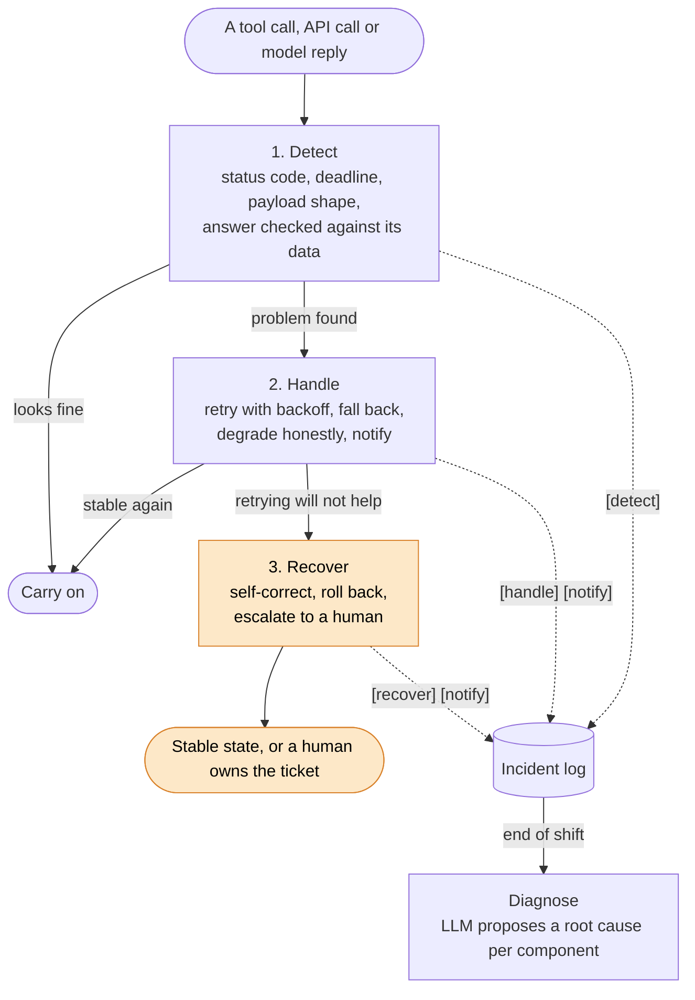
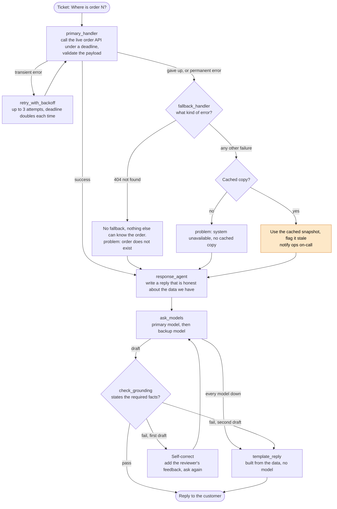
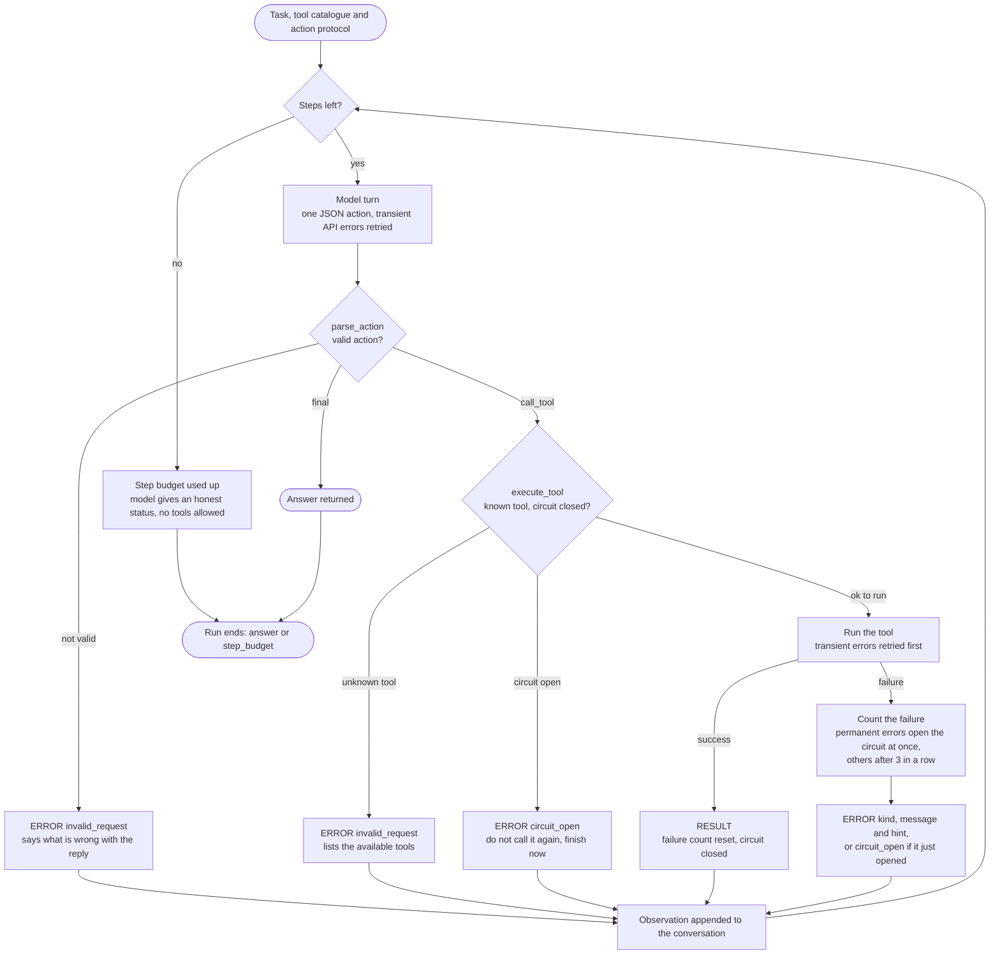
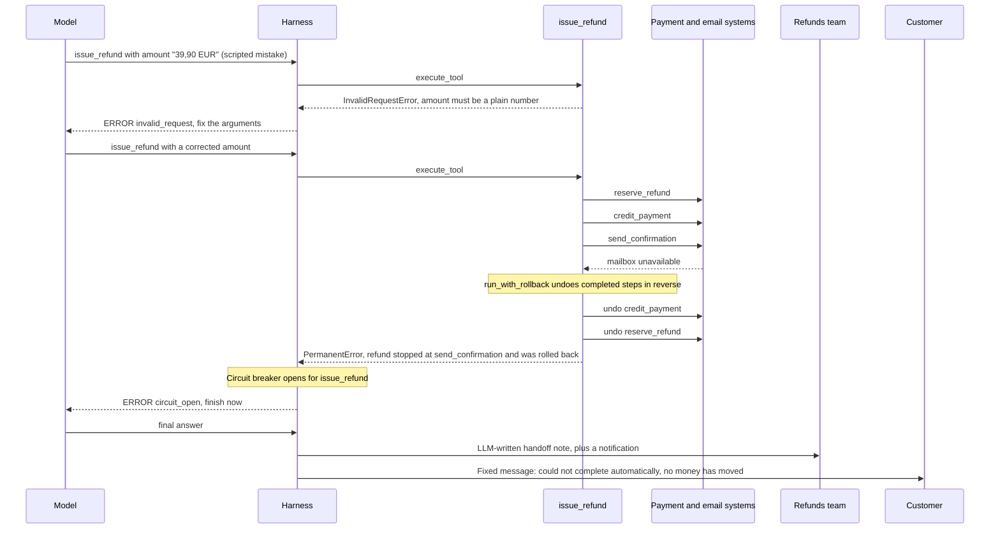

# Exception Handling and Recovery

An agent that works in the real world cannot assume everything will go right. Tools time out, services return errors or garbage, the model API throttles, the model produces a bad tool call or an answer that ignores its data, and a multi-step action can fail halfway through. This pattern gives an agent a way to notice each of these, respond in proportion, and return to a stable state instead of crashing or inventing an answer to hide the failure. It has three stages that feed one another:

- **Error detection:** spot the problem. Check HTTP status codes (a 404 and a 500 mean different things), enforce a response deadline, validate the shape of every tool payload, and review the model's answer against the data it was given.
- **Error handling:** respond right away, cheapest option first. Log the incident, retry transient errors with backoff, fall back to a backup model or a cached copy, degrade gracefully and say so, and notify a human when quality has dropped.
- **Recovery:** return to a stable state. Send tool errors back to the model so it corrects its own call, roll back a failed multi-step action with compensating "undo" steps, escalate to a human with a handoff note, and diagnose root causes from the incident log afterwards.

The code is in [main.py](main.py). The scenario is a customer-support agent working through its queue on a bad day. Failures are simulated, and the LLM calls are real.

## How it works



Every event is written to one incident log, tagged `[detect]`, `[handle]`, `[recover]` or `[notify]`, so each ticket reads as a trip around the detect, handle, recover loop. The orange nodes are where a human may get involved.

### The error taxonomy

Detection maps every failure onto a small set of classes in `classify_error()`. The class, not the original exception type, decides the response.

| Class | Examples | Retried? | Circuit breaker in the tool loop |
| --- | --- | --- | --- |
| `TransientError` | Timeout, connection error, no answer within the deadline, malformed tool payload, HTTP 408, 429 or 5xx | Yes, with backoff | Opens after 3 failures in a row |
| `InvalidRequestError` | HTTP 400 or 422, an invalid refund amount, a model reply that is not a valid action, a reply that ignores its data | No, the request must change | Opens after 3 failures in a row |
| `NotFoundError` | HTTP 404 | No | Opens after 3 failures in a row, because another id may still work |
| `PermanentError` | HTTP 401 or 403, service down, an unrecognised exception | No | Opens immediately |

Unknown errors are treated as permanent. Repeating a failure the agent does not understand is a guess.

### The pieces

| Stage | Piece | Role |
| --- | --- | --- |
| Detect | `classify_error()` | Maps SDK and HTTP exceptions onto the taxonomy above. |
| Detect | `call_with_deadline()` | Gives up on a call that takes longer than a deadline and raises a `TransientError`. |
| Detect | `validate_order()`, `validate_refund()`, `parse_action()` | Reject a malformed tool payload, bad tool arguments, or a model turn that is not a valid action. |
| Detect | `check_grounding()` | A rule-based reviewer: the answer must state the facts it was given. A second LLM could play this role for fuzzier checks. |
| Handle | `IncidentLog` | The one record of everything noticed and done. The diagnosis reads it back. |
| Handle | `retry_with_backoff()` | Retries transient errors with exponentially growing, jittered delays. Passes the attempt number to the operation so it can adjust, for example a longer deadline. Raises everything else immediately. |
| Handle | `ModelEndpoint` and `ask_models()` | Walks the model chain, primary then backup. Returns `None` if every model is down. |
| Handle | `fallback_handler()` and `template_reply()` | Serve a cached snapshot flagged as stale, or a reply built straight from the data with no model involved. |
| Recover | `run_agent()` and `execute_tool()` | The model-driven tool loop. Tool errors go back to the model as observations. A step budget and a circuit breaker are enforced by the harness, not the model. |
| Recover | `run_with_rollback()` and `PlanStep` | Runs a multi-step action. On failure, undoes the completed steps in reverse order. |
| Recover | `write_handoff_note()` | The LLM writes a short note for a human, from facts only, including the current system state. |
| Recover | `diagnose()` | One small prompt per failing component asks the LLM for a likely cause and a follow-up. |

## Order status tickets

Tickets T-101 to T-103 are a layered pipeline over shared state. Each agent reads and writes a `state` dict, so later agents know what earlier ones managed to do.



What the response agent asks for depends on the data it ended up with:

| Data | The reply must |
| --- | --- |
| Live | State the carrier and the delivery day. |
| Cached | State the delivery day and warn that the figures may be out of date. |
| None | Apologise and suggest a next step, without guessing or inventing order details. |

The model chain has a fallback of its own. Each model gets 2 attempts, and if the primary model is still failing, the backup model takes over. In production the backup would be a different provider or a smaller model. In the demo both resolve to the same local model, so you only need one `ollama pull`.

## The refund ticket

Ticket T-104 is different in kind. The model drives a tool in a loop, and the tool is a multi-step action with side effects. Failures here come back to the model as text it can act on.



Inside the `issue_refund` tool, the refund is three steps. Each is registered with a compensating undo, so a failure part-way leaves the system consistent. The scripted demo run goes like this:



- **The permanent failure is never retried.** The `PermanentError` skips `retry_with_backoff()`, so a refund that already moved money is not attempted a second time.
- **The customer message is fixed text.** Once a case is escalated, the model is not allowed to promise anything the harness has not done. The model's own final answer is discarded.
- **The handoff note states the end result.** `write_handoff_note()` is told the current system state explicitly, because models misread a list of "completed" steps as the current state even when those steps were later undone.
- **Escalation also covers a stuck loop.** If the circuit opens or the step budget runs out before any refund step ran, the case is still escalated and nothing was changed.

## The demo scenario

| Ticket | Question | What goes wrong | How the agent responds |
| --- | --- | --- | --- |
| T-101 | Where is order 4821? | The order API is slow, then returns a payload with no carrier or ETA. Then the model's first draft ignores the data and talks about an invoice. | The 0.2s deadline fires and the call is retried with a 0.4s deadline. The malformed payload is rejected and retried again. The third attempt succeeds. The grounding check rejects the draft, and the model is asked to rewrite it. |
| T-102 | Where is order 7310? | The order API returns a 500 on every call. | Three attempts, then it gives up. The agent falls back to the cached snapshot, flags it as stale, and notifies ops on-call. The reply carries an out-of-date warning. |
| T-103 | Where is order 0001? | The order does not exist (404), and the primary model returns a 503 on every call. | The 404 is not retried and has no fallback. The primary model is retried once, then the backup model writes the apology. |
| T-104 | Refund order 4821, 39.90 EUR | The model's first tool call has an invalid amount. Then the confirmation email fails after the money has already been credited. | The error goes back to the model, which corrects the amount. The refund is rolled back, the circuit breaker disables the tool, and the case is escalated to the refunds team with a handoff note. |

After the last ticket, `diagnose()` groups the problems in the incident log by component and asks the LLM for a likely cause and a follow-up for each one.

## Running it

Ollama must be running with the `llama3.2` model. See the [setup instructions](../../README.md#setup) in the root README. From the repository root:

```bash
pip install -r 03-capability-patterns/12-exception-handling-and-recovery/requirements.txt

python 03-capability-patterns/12-exception-handling-and-recovery/main.py
```

Each line of the incident log is printed as it happens, tagged by stage and ticket. For example, ticket T-102 ends like this (the retry delays are jittered, so they differ from run to run):

```text
[detect ] T-102 live order API: transient - 500 internal server error
[handle ] T-102 live order API: giving up after 3 attempts
[handle ] T-102 fallback: live order API -> cached snapshot
[handle ] T-102 graceful degradation: answering from the cached snapshot and flagging it as possibly out of date
[notify ] T-102 ops on-call: live order API is failing; the agent is serving cached data
```

## Tuning

| Setting | Where | Default |
| --- | --- | --- |
| Retry attempts and base delay | `retry_with_backoff(max_attempts=..., base_delay=...)` | `3` and `0.1s` |
| Deadline for the live order API | `primary_handler()`, `deadline = 0.2 * 2 ** (attempt - 1)` | `0.2s`, doubling each attempt |
| Attempts per model before falling back | `ask_models()`, `max_attempts` | `2` |
| Reply review attempts | `response_agent()`, `for attempt in (1, 2)` | `2` |
| Step budget for the tool loop | `run_agent(max_steps=...)` | `6` |
| Failures before a tool's circuit opens | `run_agent(failure_limit=...)` | `3` |
| The failures themselves | `OrderAPI.script`, `ModelEndpoint.faults`, `RefundDesk(email_up=...)` | see `status_tickets()` and `run_refund_ticket()` |
| Chat model | `MODEL` | `llama3.2` |

## Things to know

- **The failures are simulated, the model is real.** `OrderAPI`, `ModelEndpoint.faults` and `RefundDesk` script what breaks. The replies, self-corrections, handoff note and diagnosis come from `llama3.2`, so their wording changes from run to run.
- **Two model turns are scripted.** T-101's first draft and T-104's first tool call are fixed so the demo always exercises self-correction. Every later turn is the real model.
- **A 429 is treated as transient.** A 429 for an exhausted quota is really permanent. In production, inspect the error code before treating every rate limit as retryable.
- **A timed-out call is not cancelled.** `call_with_deadline()` stops waiting, but the worker thread runs to completion in the background. That is fine for a read-only lookup. For a call with side effects you would need real cancellation or an idempotency key.
- **The grounding check is rule-based.** It looks for the carrier, the delivery day and a stale-data phrase. It catches a reply that ignores its data, not one that states the right facts and adds a wrong one.
- **Small-model output is imprecise.** If the model fails the grounding check twice, the agent uses `template_reply()`, which is built from the data directly. That is the designed last resort, not a bug.
