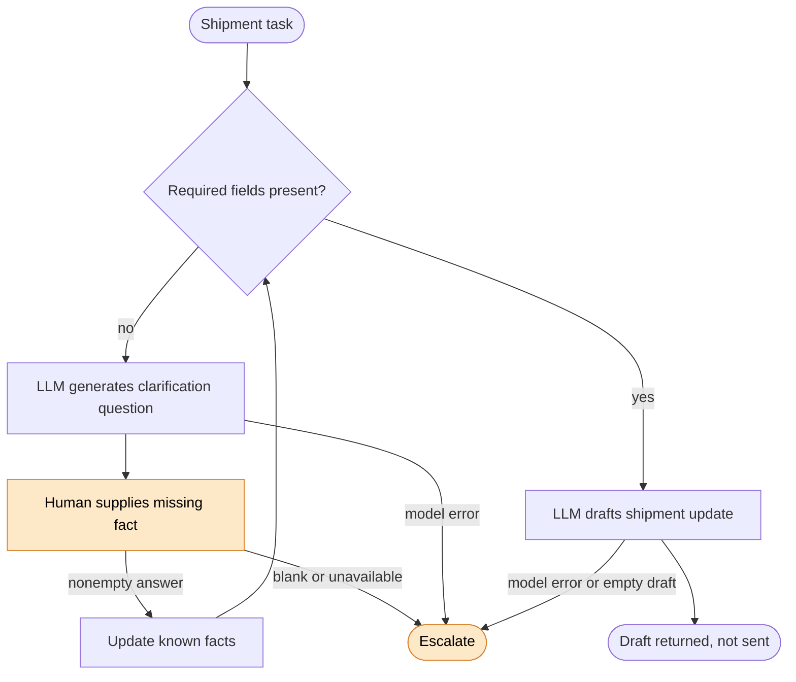
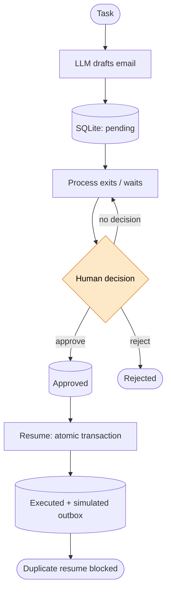

# Human-in-the-Loop (HITL)

An agent can draft a response or propose an action without being trusted to carry it out autonomously. Human-in-the-loop puts a person inside the workflow at a meaningful decision point. They can approve the exact proposal, reject it, ask the agent to revise it, or take ownership of the task.

The code is in [main.py](main.py). A customer-support agent drafts emails with a real local LLM; the email delivery is simulated. The harness enforces the approval policy independently of the model.

## Variations

| Variation | Human involvement | When to use |
| --- | --- | --- |
| 1. Approval and revision | Review an exact draft; approve, reject, revise or take over. | Risky actions need a human gate before execution. |
| 2. Human clarification | Supply missing facts before the agent completes a draft. | The agent cannot proceed without verified information. |
| 3. Persistent approval | Review a stored proposal and resume it later. | A human may respond after the original process has stopped. |

The first variation lives in [main.py](main.py); the other two are implemented in [variations.py](variations.py). All share the same CLI and local model configuration.

## Variation 1: Approval and revision


| Decision | What happens |
| --- | --- |
| Auto-allow | The trusted ticket policy permits a low-risk draft to be sent without review. |
| Approve | Send the exact draft that was reviewed, without another model call. |
| Reject | Stop without sending. |
| Revise | Feed the human's feedback and previous draft to the model; require fresh approval. |
| Take over | Return the ticket and last draft to the human; the agent stops. |
| Unavailable or invalid | Escalate without sending. |

The revision limit is enforced in Python, not by a prompt. Each draft attempt and decision is recorded as an event in an in-memory audit trail; only the last draft is retained in the result. This is distinct from exception handling: human review is an intentional part of normal execution, not merely an emergency fallback.

## Variation 2: Human clarification

The shipment agent knows the order and carrier but does not have the tracking number. A deterministic check identifies the missing field. The model generates a question, a human supplies the answer, and the agent continues using the updated facts. If the human cannot answer, the agent escalates instead of inventing a tracking number.



The workflow is bounded by the number of required fields. The example checks for nonempty strings, not the truth of the human's answer or every factual claim in the model's draft. Production agents should validate supplied identifiers against trusted systems before use.

## Variation 3: Persistent pause and resume

A model drafts a support email. The harness stores its exact text and a unique request ID in SQLite with status `pending`. The process can exit. A reviewer opens the stored proposal later, approves or rejects it, and a separate execution step resumes the approved request. No regeneration is allowed after approval.



The `ApprovalStore` uses conditional SQL updates so a pending or rejected request cannot execute, and a decision cannot overwrite an earlier decision. A single transaction changes the approved status to executed and writes the exact stored draft to an outbox row. Even concurrent resume attempts can record at most one simulated delivery. The outbox is the demo side effect, not a real email delivery service.

## Running it

Start Ollama and pull the default model as described in the [setup instructions](../../README.md#setup). From the repository root:

```bash
pip install -r 03-capability-patterns/13-human-in-the-loop/requirements.txt

# Interactive review in the terminal
python 03-capability-patterns/13-human-in-the-loop/main.py

# Scripted review decisions with real LLM calls
python 03-capability-patterns/13-human-in-the-loop/main.py --demo

# Variation 2: human clarification (omit --demo for terminal input)
python 03-capability-patterns/13-human-in-the-loop/main.py --variation clarification --demo

# Variation 3: persistent approval, scripted walkthrough
python 03-capability-patterns/13-human-in-the-loop/main.py --variation checkpoint --demo

# All three variations in one run
python 03-capability-patterns/13-human-in-the-loop/main.py --variation all --demo
```

| Ticket | Scenario | Expected outcome in demo |
| --- | --- | --- |
| T-201 | Routine shipment update | Auto-allowed |
| T-202 | Refund request | Approved and sent |
| T-203 | Delayed delivery | Revised, reviewed again, then sent |
| T-204 | Charge dispute | Rejected |
| T-205 | Manager request | Human takeover |
| T-206 | Reviewer unavailable | Escalated |

The expected outcomes assume the model successfully generates nonempty drafts. Model errors also escalate rather than silently bypassing the gate.

### Resume across separate processes

Use the same database and copy the request ID printed by the first command. Choose a database path outside the repository or exclude it from version control.

```bash
# Generate and persist the proposal (requires Ollama)
python 03-capability-patterns/13-human-in-the-loop/main.py --variation checkpoint --checkpoint-action propose --db /tmp/hitl-approvals.sqlite3

# View the proposal later (does not require Ollama)
python 03-capability-patterns/13-human-in-the-loop/main.py --variation checkpoint --checkpoint-action show --db /tmp/hitl-approvals.sqlite3 --request-id REQUEST_ID

# Review the exact draft and type approve or reject
python 03-capability-patterns/13-human-in-the-loop/main.py --variation checkpoint --checkpoint-action decide --db /tmp/hitl-approvals.sqlite3 --request-id REQUEST_ID

# Resume an approved proposal; repeated execution is blocked
python 03-capability-patterns/13-human-in-the-loop/main.py --variation checkpoint --checkpoint-action execute --db /tmp/hitl-approvals.sqlite3 --request-id REQUEST_ID
```

The demo uses a temporary database; the separate-process example persists the database you specify. SQLite is included in Python, so no extra dependency is needed.

## Production considerations

- The demo uses a preassigned risk flag as trusted policy metadata. In production, classify risk using verified action types and permissions, and default to review when uncertain.
- A prompt is not a safety boundary. The model never has access to the delivery function. Only the orchestration code can invoke it. The example checks for a nonempty draft but does not independently verify every factual claim.
- Bind approval to an immutable action payload (including recipient and parameters), authorized reviewer identity, expiry and request ID. Persist decisions and enforce single-use authorization.
- Variation 3 demonstrates durable resumption with a local SQLite database and a transactional simulated outbox. It does not implement authenticated reviewers, approval expiry, notifications, encrypted storage, or an external delivery worker. Real external side effects require idempotency and reconciliation; the local transaction alone cannot guarantee exactly-once external delivery.
- Store an appropriate audit log, use idempotency keys for side effects, and reconcile ambiguous delivery failures before retrying.
- Scripted decisions are for demonstrations only. Real deployment requires authenticated reviewers and actual approval decisions.
