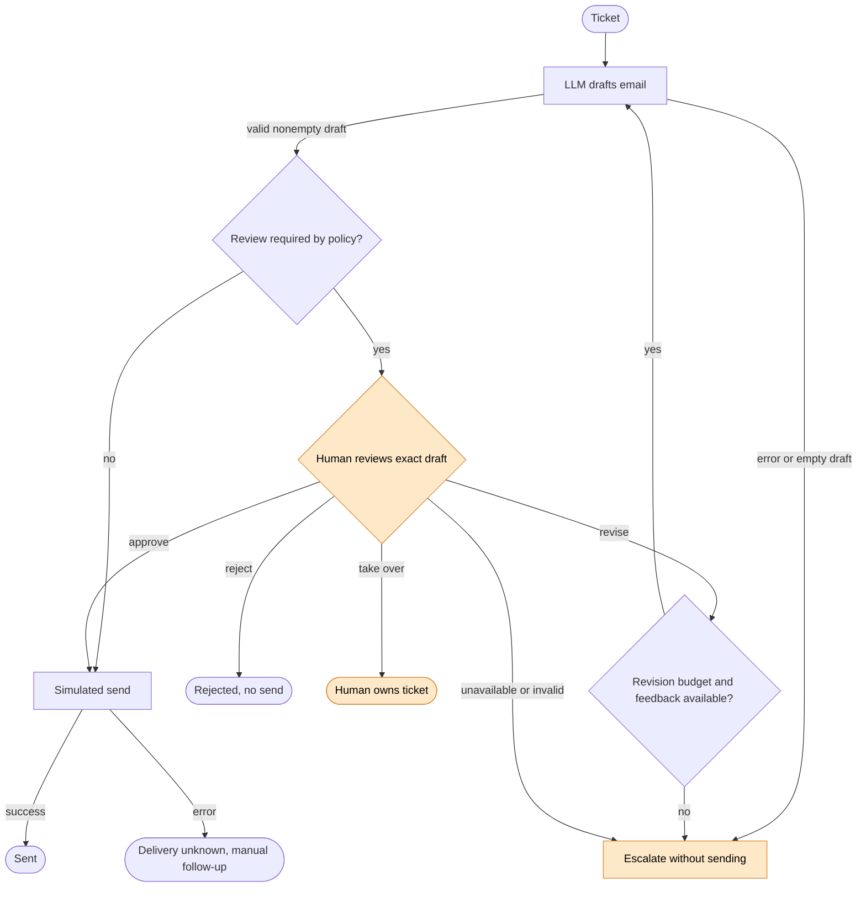

# Human-in-the-Loop (HITL)

An agent can draft a response or propose an action without being trusted to carry it out autonomously. Human-in-the-loop puts a person inside the workflow at a meaningful decision point. They can approve the exact proposal, reject it, ask the agent to revise it, or take ownership of the task.

The code is in [main.py](main.py). A customer-support agent drafts emails with a real local LLM; the email delivery is simulated. The harness enforces the approval policy independently of the model.

## How it works



| Decision | What happens |
| --- | --- |
| Auto-allow | The trusted ticket policy permits a low-risk draft to be sent without review. |
| Approve | Send the exact draft that was reviewed, without another model call. |
| Reject | Stop without sending. |
| Revise | Feed the human's feedback and previous draft to the model; require fresh approval. |
| Take over | Return the ticket and last draft to the human; the agent stops. |
| Unavailable or invalid | Escalate without sending. |

The revision limit is enforced in Python, not by a prompt. Every draft and decision is recorded in an in-memory audit trail. This is distinct from exception handling: human review is an intentional part of normal execution, not merely an emergency fallback.

## Running it

Start Ollama and pull the default model as described in the [setup instructions](../../README.md#setup). From the repository root:

```bash
pip install -r 03-capability-patterns/13-human-in-the-loop/requirements.txt

# Interactive review in the terminal
python 03-capability-patterns/13-human-in-the-loop/main.py

# Scripted review decisions with real LLM calls
python 03-capability-patterns/13-human-in-the-loop/main.py --demo

# Unit tests, no Ollama or third-party dependencies required
python -m unittest discover -s 03-capability-patterns/13-human-in-the-loop -p 'test_*.py'
```

| Ticket | Scenario | Expected outcome in demo |
| --- | --- | --- |
| T-201 | Routine shipment update | Auto-allowed |
| T-202 | Refund request | Approved and sent |
| T-203 | Delayed delivery | Revised, reviewed again, then sent |
| T-204 | Charge dispute | Rejected |
| T-205 | Manager request | Human takeover |
| T-206 | Reviewer unavailable | Escalated |

The expected outcomes assume the model successfully generates nonempty drafts. Model errors also escalate rather than silently bypassing the gate.

## Production considerations

- The demo uses a preassigned risk flag as trusted policy metadata. In production, classify risk using verified action types and permissions, and default to review when uncertain.
- A prompt is not a safety boundary. The model never has access to the delivery function. Only the orchestration code can invoke it. The example checks for a nonempty draft but does not independently verify every factual claim.
- Bind approval to an immutable action payload (including recipient and parameters), authorized reviewer identity, expiry and request ID. Persist decisions and enforce single-use authorization.
- For asynchronous approvals, persist workflow state, use deadlines, and resume from the exact checkpoint. The CLI pauses synchronously; it does not demonstrate durable resumption.
- Store an appropriate audit log, use idempotency keys for side effects, and reconcile ambiguous delivery failures before retrying.
- Scripted decisions are for demonstrations only. Real deployment requires authenticated reviewers and actual approval decisions.
